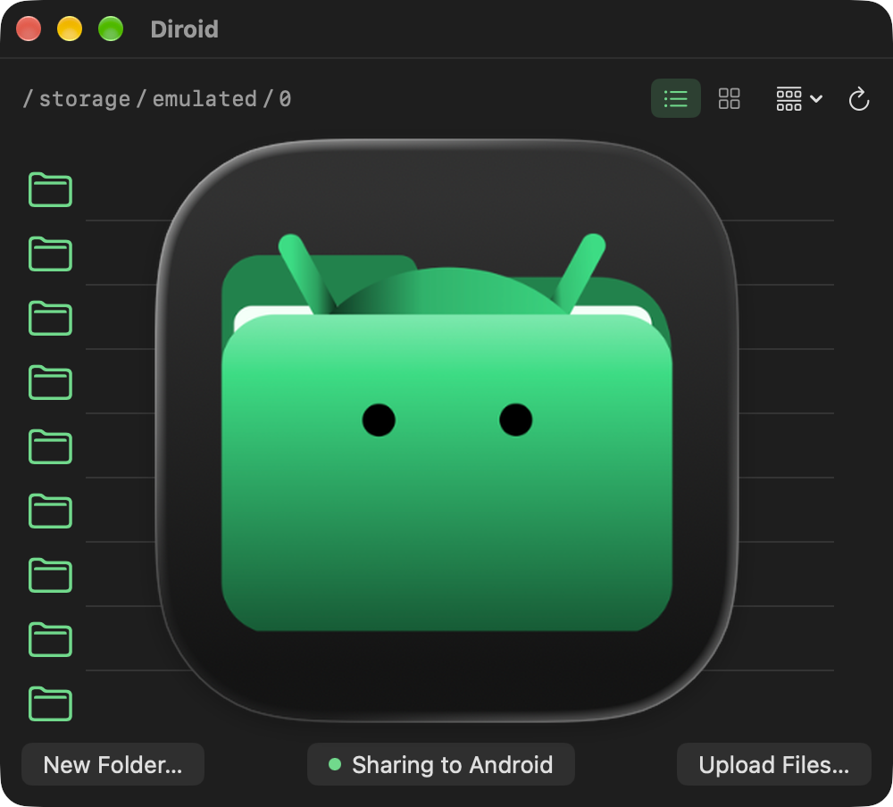
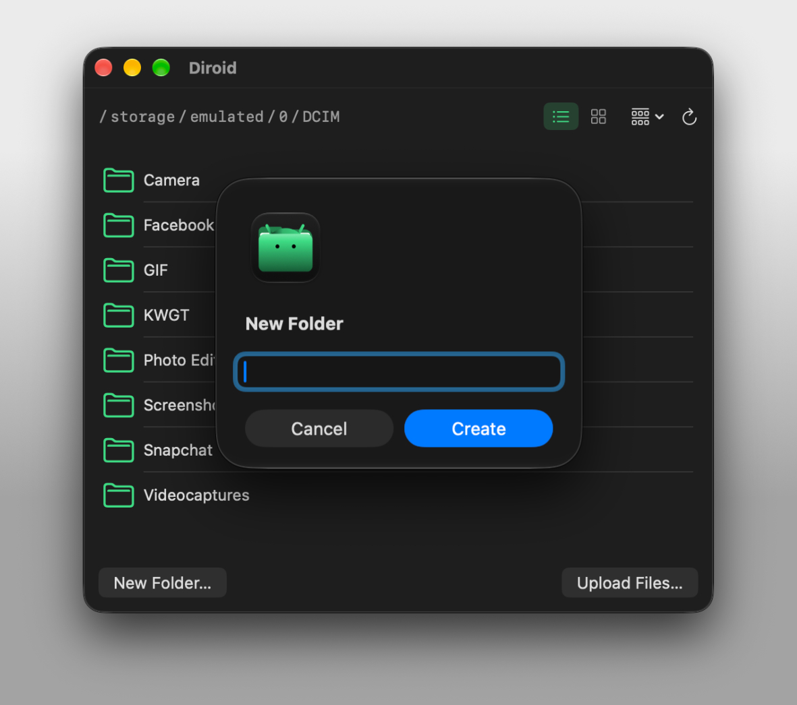
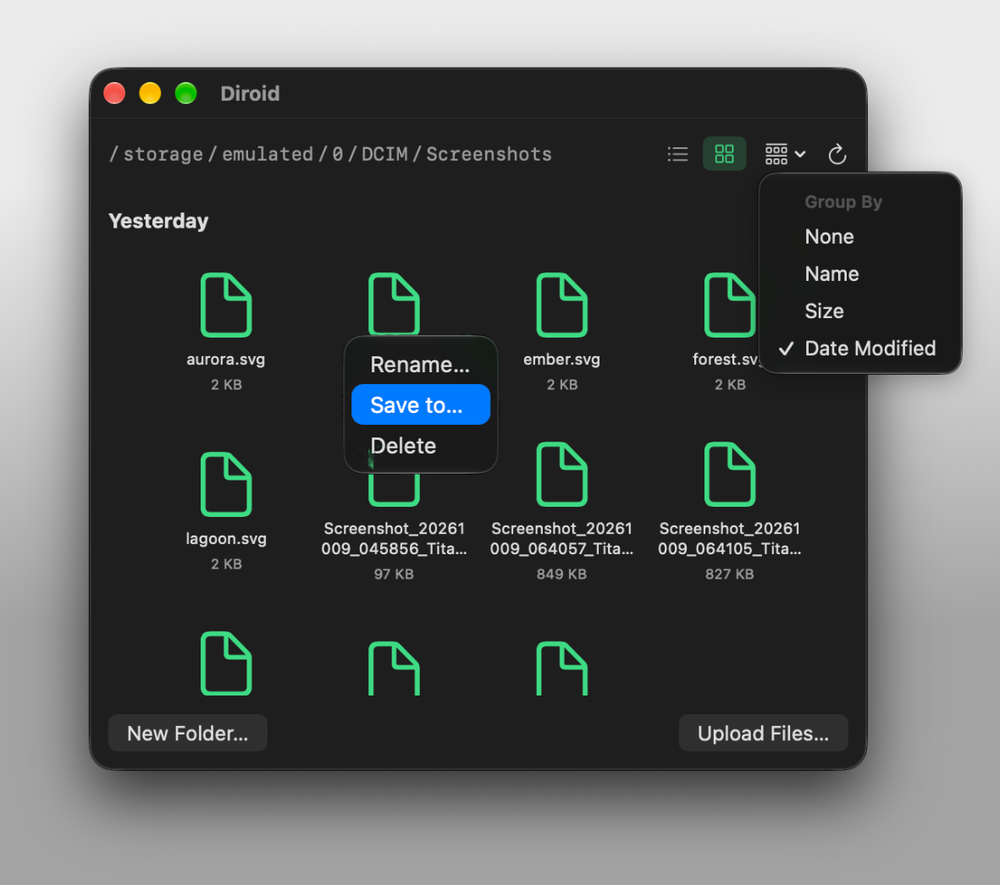

# Diroid

<p align="center">
  
</p>

<p align="center"><em>Pronounced "dir-oid"</em></p>

A native macOS app for browsing your Android device's storage over USB, and for sharing a Mac folder back to it
- no MTP
- no kernel extension
- no background daemon

## What is this?

- macOS has no built-in way to see an Android device's files when you plug it in over USB. 
Every existing solution wraps `libmtp` in a FUSE filesystem, which means a kernel extension, kernel-level trust, and (in practice) a lot of flakiness getting it to actually mount.
- Diroid uses Android's USB debugging protocol (ADB) directly to the local `adb` server the same way Android Studio's "Device File Explorer" does but reimplemented from scratch in Swift.
- No `adb` binary shelled out to, no third-party libraries, no elevated privileges, no daemons running in the background.

## Features

- Browse your Android device's storage like a Finder window.
- A sidebar with your device's name and its top-level folders
- List and Grid views (toggle in the toolbar), groupable by Name, Size, or Date Modified
- Double-click a file to pull it and open it in the default app macOS would use for that file type
- Right-click → **Save to…** to copy a file to a folder you choose, without opening it
- Right-click → **Rename…** to rename or move a file or folder
- Right-click → **Delete** to remove a file, or a folder and everything in it (with a confirmation prompt first)
- **New Folder…** toolbar button to create a folder in the current directory
- **Upload Files…** toolbar button to push local files onto the Android device
- The path bar at the bottom shows where you are; click any segment to jump to that folder
- The whole filesystem is browsable (permission-restricted system folders show an error)
- **Refresh** (↻) toolbar button to reconnect after unplugging/replugging your Android device
- If the `adb` server isn't running, Diroid says so and shows the command to start it, with a copy button for pasting into Terminal

### Screenshots



List view, and the New Folder dialog.



Grid view, the Group By menu (top right), and the right-click menu on a file.

## Share Mac to Android

Browse a Mac folder from the Android device, over the same USB cable.

1. Install the Diroid app on the Android device (see [Install](#install)).
2. In Diroid, click **Share Mac to Android** in the toolbar and choose the folder to share. The picker opens in iCloud Drive the first time, then at your last folder. Sharing starts when you pick it.
3. The Diroid app opens on the Android device showing that folder: list or grid, group by, open files, **Save to…** or **Move to this device…**, **Upload** (copy or move), rename, new folder, delete.

While sharing, the button turns green and reads **Stop Sharing**; click it to end. To share a different folder, stop and click again.

- **How it works:** Diroid serves the folder from a small HTTP server on the Mac's loopback address (127.0.0.1:47615) and exposes it to the Android device with `adb reverse`, over the same adb server connection. No network or Wi-Fi involved.
- **Locked down:** `adb reverse` opens the port to every app on the Android device, so each request needs a random token that Diroid passes to the app when it launches it, and a new one is made every time sharing starts. Only the chosen folder is served; symlinks leading outside it are hidden.
- **Nothing is overwritten:** an upload with a taken name is renamed ("name (1)"). Deleting from the Android device moves the item to the Mac's Trash.
- **App not installed:** Diroid says so and offers to open the app's Google Play page or the APK download on the Android device.
- **Limits:** USB only, one device at a time (the first one adb lists), and sharing stops when Diroid quits or the cable is unplugged.

Browsing the Android device from the Mac doesn't need the Android app.

## Install

With [Homebrew](https://brew.sh) (Apple silicon Macs):

```bash
brew install --cask ike-V/diroid/diroid
```

### First launch: macOS blocks it

Diroid isn't signed with an Apple Developer ID or notarized yet, so macOS blocks it the first time ("Apple could not verify Diroid is free of malware"). Do one of these, once:

- **Terminal:** `xattr -dr com.apple.quarantine /Applications/Diroid.app`
- **System Settings:** try to open Diroid, then go to System Settings → Privacy & Security, scroll to **Security**, and click **Open Anyway**.

Diroid also needs an `adb` server running — see Requirements.

### Android app

Only needed for [Share Mac to Android](#share-mac-to-android). Neither link works yet:

- [Google Play](https://play.google.com/store/apps/details?id=com.ikev.diroid): not published yet
- [GitHub Releases](https://github.com/ike-V/Diroid/releases/latest): APK, first release pending

Or build it (Android SDK and Gradle, or Android Studio) and install it:

```bash
cd android
gradle assembleDebug
adb install -r app/build/outputs/apk/debug/app-debug.apk
```

## Requirements

- macOS 13 (Ventura) or later
- An Android device with **USB debugging** enabled: Settings → About phone (or About tablet) → tap "Build number" 7 times to unlock Developer options → Developer options → USB debugging
- The `adb` server running on your Mac — easiest way is Homebrew: `brew install --cask android-platform-tools`. Diroid talks to this same background server; it doesn't shell out to the `adb` binary itself.
- For Share Mac to Android: the Diroid app on the Android device (Android 8.0 or later)
- To build from source: Xcode, set as the active developer directory: `sudo xcode-select -s /Applications/Xcode.app` (the Command Line Tools alone can't build SwiftUI's `@State` macro on the macOS 27 SDK)

## Build from source

```bash
git clone https://github.com/ike-V/Diroid.git
cd Diroid
./build.sh
open Dirian.app
```

## First run

- Plug in your Android device before or after launching 
- The first time, you'll get a prompt on the Android device itself asking to authorize this computer for USB debugging; accept it (check "always allow" to skip this next time).
- If you unplug/replug while the app is already open, hit the refresh (↻) button.

## Credits

The Android robot in the app icon is reproduced or modified from work created and shared by Google and used according to terms described in the [Creative Commons 3.0 Attribution License](https://creativecommons.org/licenses/by/3.0/).

## License

All rights reserved. See [LICENSE](LICENSE).
