# Dirian

<p align="center"> </p>

<p align="center">A native macOS app for browsing an Android device's files over USB.</p>
<p align="center">
  
</p>


<p align="center">No MTP, no kernel extension, no additional background processes</p>
<p align="center">
  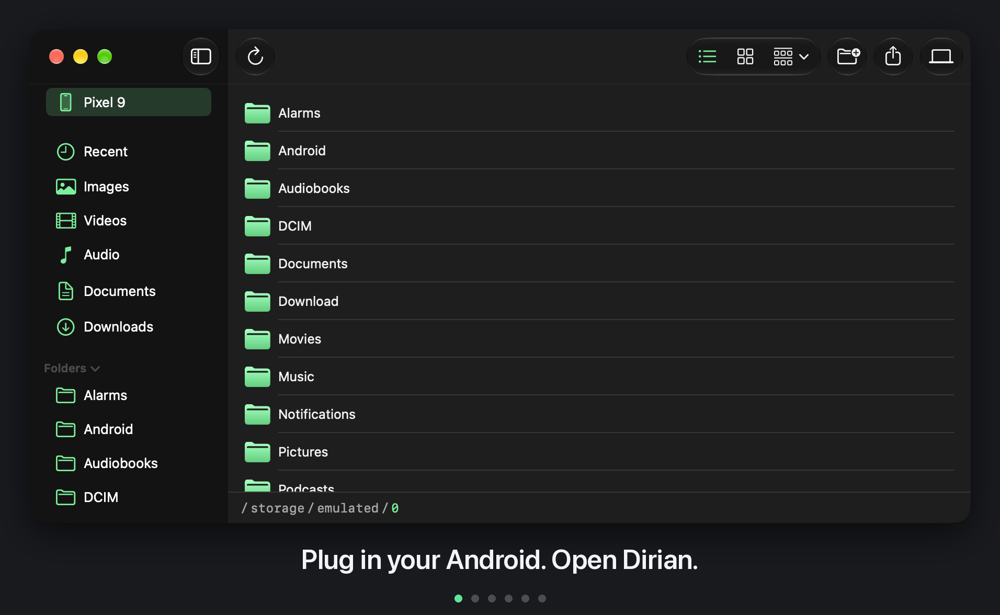
</p>

<p align="center">share a selected directory back to Android.</p>

<p align="center">
  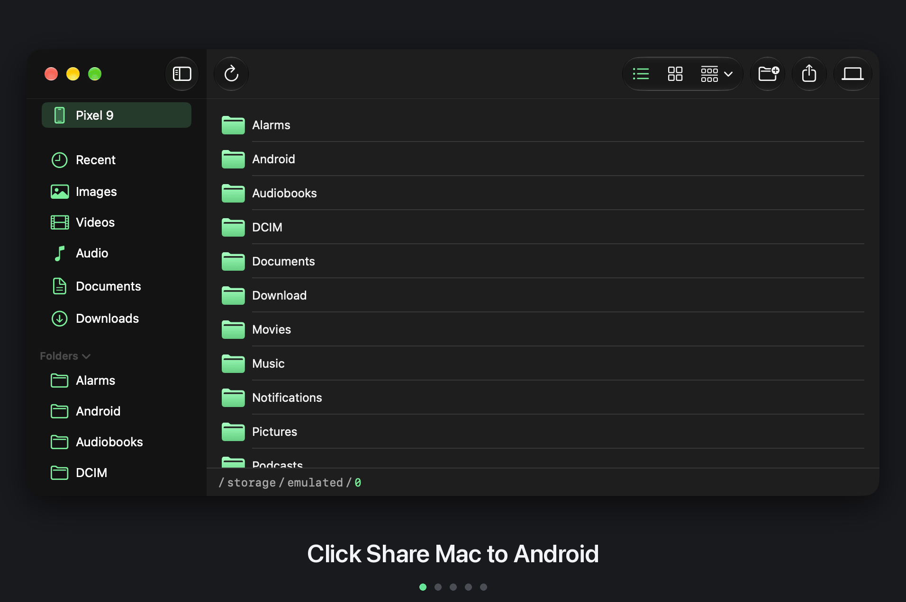
</p>

## What you need

- **adb (required).** Dirian reads your Android device through the adb server, so adb (the Android Debug Bridge) must be installed and running on your Mac. It comes with Android Studio, in the SDK's platform-tools. You can also install it on its own with `brew install --cask android-platform-tools`. See [adb](#adb) for details.
- **An Android device with USB debugging turned on**, plugged in over USB.
- **Dirian for Android (optional).** [Share Mac to Android](#share-mac-to-android) needs the Dirian for Android app installed. Browsing, uploading, downloading, renaming, deleting and everything else in Dirian works with just the macOS application.

## Why Dirian?

- macOS can't show an Android device's files when you plug it in over USB. 
- Existing tools wrap `libmtp` in a FUSE filesystem, which needs a kernel extension and is often unreliable to mount.
- Leveraging `android-platform-tools`, Dirian talks to the `adb` server, using Android's USB debugging protocol, the same way Android Studio's Device File Explorer does.
- It doesn't run the `adb` binary, uses no third-party libraries and needs no elevated privileges.
- A native SwiftUI app, not a cross-platform port.

## Features

### Browse

- Browse your Android device's storage like a Finder window.
- The whole filesystem is browsable, and permission-restricted system folders show an error.
- Sidebar shows the device's name and top-level folders, which you can collapse.
- The sidebar shows Recent, Images, Videos, Audio, Documents and Downloads list matching files from Android's common folders.
<p align="center"> 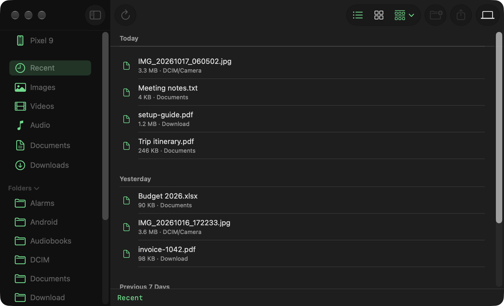</p>
<p align="center">Recent, grouped by date.</p>

- List and Grid views, grouped by Name, Size or Date Modified

<p align="center"> </p><p align="center">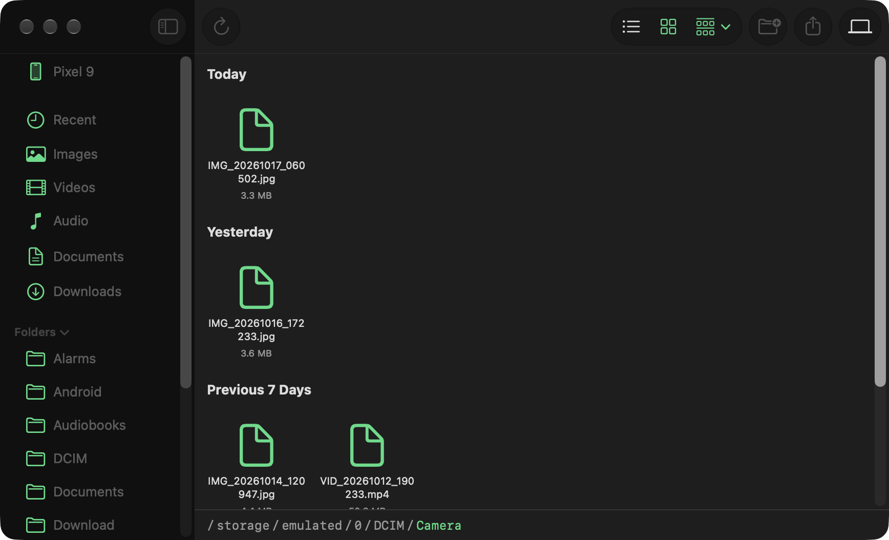 </p>
<p align="center">Grid view, and path bar</p>

<p align="center">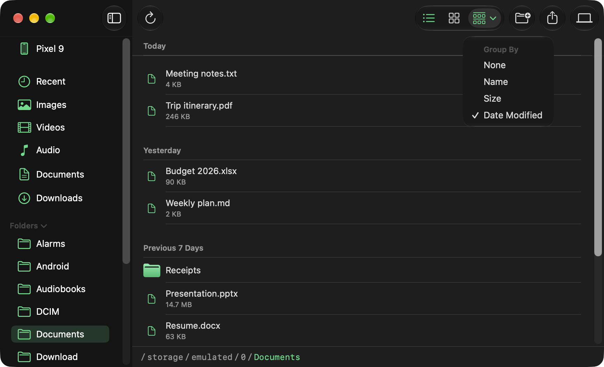 </p>

<p align="center">The Group By menu in the toolbar. </p>

- Click any path segment to jump to that parent directory

### Manage files

- Double-click a file to pull it and open it in the default Mac app for its type.
- Right-click → **Save to…** copies a file to a folder you choose, without opening it.
- Right-click → **Rename…** renames or moves a file or folder.
- Right-click → **Delete** removes a file, or a folder and everything in it, after a confirmation prompt.

<p align="center">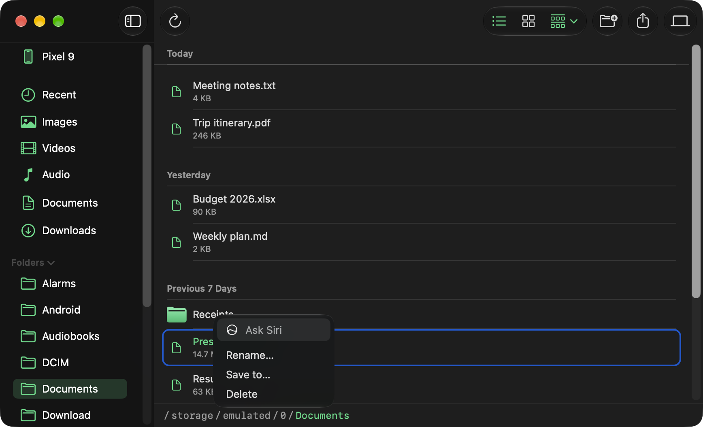</p>
<p align="center">Right-click menu on a file.</p>

- **New Folder…** creates a folder in the current directory.

<p align="center">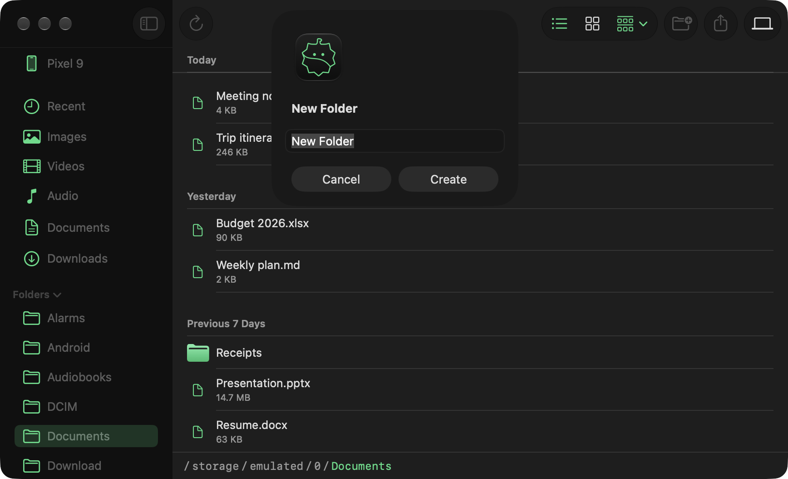</p>
<p align="center">List view, and the New Folder dialog.</p>

- **Upload Files…** pushes local files to the Android device.

### Make it yours

- **Accent color.** Settings → Appearance (⌘,) picks the color of icons, folders and highlights from Finder's tag colors. Android uses the same color when you share a folder to it.
- **App icon.** The Dirian icon can be changed in Settings → Appearance → App icon *(switches the Dock icon only)*
- **Sidebar.** Settings → Sidebar chooses shortcuts and which folders appear in the sidebar. A hidden folder is still there. Open the device's root folder to browse to it.

<p align="center">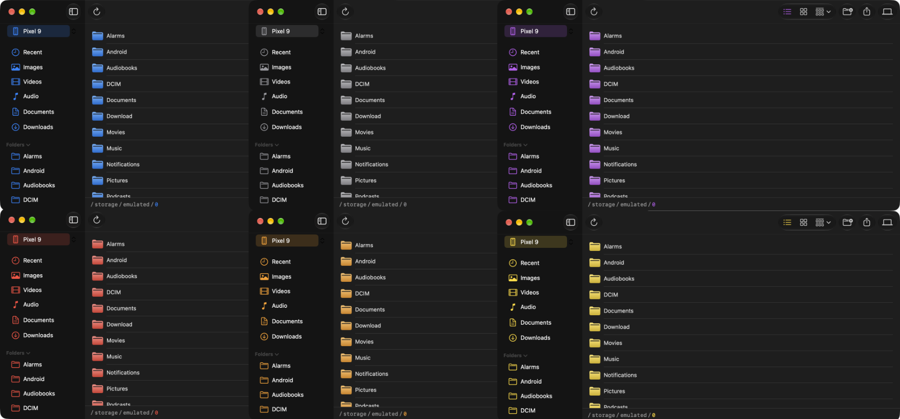</p>
<p align="center">Dirian in Blue, Gray, Purple, Red, Orange and Yellow. Green is the default.</p>

<p align="center">
  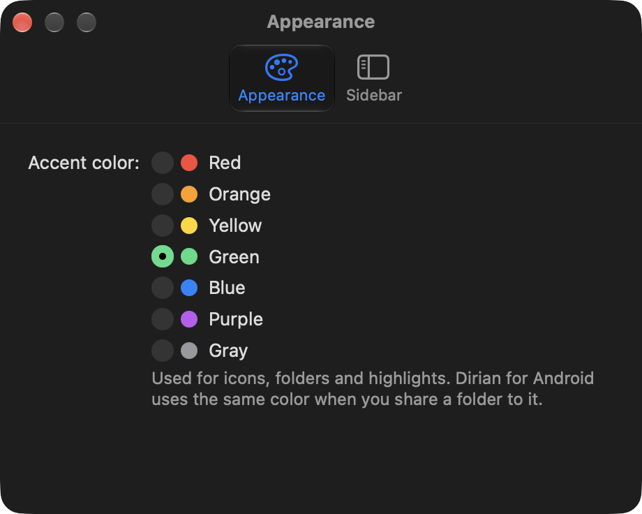
  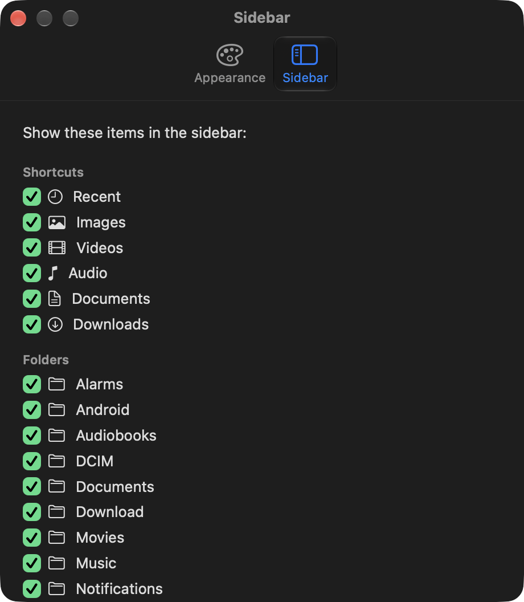
</p>
<p align="center">Appearance and Sidebar settings.</p>

### Updates

- When Dirian opens, it reads the latest release number from GitHub, at most once a day, and shows a message when a newer version is out. Nothing from your device or your files is sent.
- **Settings → General → Check for Updates…** checks right away. The same page turns the automatic check off.
- With Homebrew, update with `brew upgrade --cask dirian`. Otherwise download the new version from the [releases page](https://github.com/ike-V/Dirian/releases).

### Connection

- With more than one device connected, a switcher beside the device name in the sidebar chooses which one to browse and share to. Dirian remembers your choice.
- **Refresh** (↻) reconnects after you unplug and replug the device.
- If the device says "unauthorized", unlock it and tap **Allow** on the USB debugging prompt. Dirian shows the steps to take when no prompt appears.
- If the `adb` server isn't running, Dirian says so and shows the command to start it, with a copy button for pasting into Terminal.

Dirian can also share a Mac folder back to the device. See [Share Mac to Android](#share-mac-to-android).

## Share Mac to Android

Dirian can share a Mac folder to the Android device over the same USB cable, so you can browse it from the device. This is the only feature that needs Dirian for Android. Everything else in Dirian, including browsing the device from your Mac, works without the Android app.

1. Install Dirian for Android on the device (see [Dirian for Android](#dirian-for-android)).
2. In Dirian, click **Share Mac to Android** in the toolbar and choose the folder to share. The picker opens in iCloud Drive the first time, then at your last folder. Sharing starts when you pick it.
3. Dirian for Android opens on the device showing that folder: list or grid, group by, open files, **Save to…** or **Move to this device…**, **Upload** (copy or move), rename, new folder and delete.


<p align="center">
  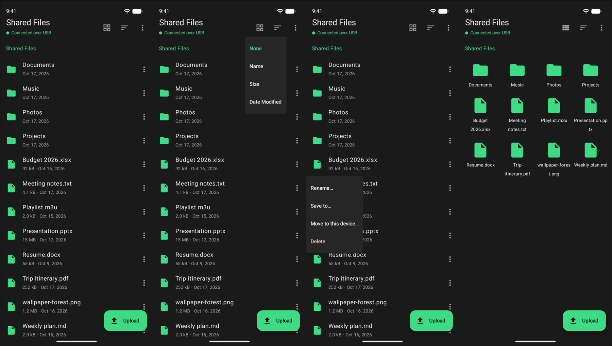
</p>
<p align="center">Dirian for Android shared from Mac folder</p>

<p align="center">
  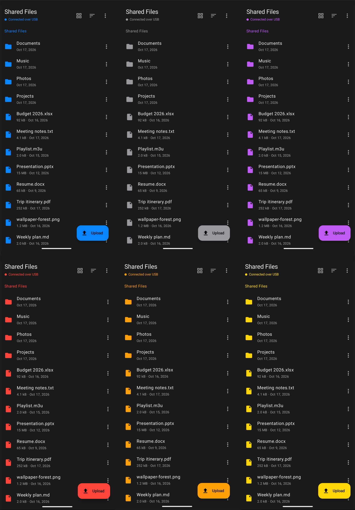
</p>
<p align="center">Dirian for Android accent color chosen on Mac</p>

### How it works

- **Serving:** Dirian serves the folder from a small HTTP server on the Mac's loopback address (127.0.0.1:47615) and exposes it to the Android device with `adb reverse`, over the same adb server connection. No network or Wi-Fi is involved.
- **Security:** `adb reverse` opens the port to every app on the Android device, so each request needs a random token that Dirian passes to Dirian for Android when it launches it. A new token is made every time sharing starts. Only the chosen folder is served, and symlinks that lead outside it are hidden.

### Good to know

- **Nothing is overwritten:** an upload with a taken name is renamed ("name (1)"). Deleting from the Android device moves the item to the Mac's Trash.
- **App not installed:** if Dirian for Android isn't installed, Dirian offers to open its Google Play page or the APK download on the Android device.
- **Limits:** USB only, one device at a time and sharing stops on quit or the cable is unplugged.

## Install

With [Homebrew](https://brew.sh) (Apple silicon Macs):

```bash
brew install --cask ike-V/dirian/dirian
```

Dirian requires adb, which comes with Android Studio's platform-tools (or install it on its own: `brew install --cask android-platform-tools`). Without a running adb server, Dirian shows an error instead of your files. See [adb](#adb).

### First launch: macOS blocks

Dirian isn't signed with an Apple Developer ID or notarized, so macOS blocks it the first time ("Apple could not verify Dirian is free of malware"). Do one of these:

- **Terminal:** `xattr -dr com.apple.quarantine /Applications/Dirian.app`
- **System Settings:** try to open Dirian, then go to System Settings → Privacy & Security, scroll to **Security**, and click **Open Anyway**.

### Dirian for Android

This is optional. Only [Share Mac to Android](#share-mac-to-android) needs it, and everything else in Dirian works without it. It needs Android 8.0 or later. Get it from one of these:

- **Google Play:** [not published yet](https://play.google.com/store/apps/details?id=com.ikev.dirian).
- **GitHub Releases:** download `Dirian-for-Android-0.2.4.apk` from the [v0.3.12 release](https://github.com/ike-V/Dirian/releases/tag/v0.3.12) on your Android device, open it, and allow your browser to install unknown apps if Android asks. The APK is signed, and its SHA-256 is listed in the release notes.

Or build it (Android SDK and Gradle, or Android Studio) and install it:

```bash
cd android
gradle assembleDebug
adb install -r app/build/outputs/apk/debug/app-debug.apk
```

## Requirements

- macOS 13 (Ventura) or later.
- **adb, running on your Mac.** Required. See [adb](#adb) below.
- An Android device with **USB debugging** enabled: Settings → About phone (or About tablet) → tap "Build number" 7 times to unlock Developer options → Developer options → USB debugging.
- Optional, for Share Mac to Android only: Dirian for Android on the device (Android 8.0 or later).

### adb

Dirian can't see your device without adb. It doesn't run the `adb` binary. It connects to the adb server, which listens on `127.0.0.1:5037`. adb itself has to be installed so that server exists and is running. Get it from either of these:

- **Android Studio.** Its SDK includes adb in the platform-tools folder, at `~/Library/Android/sdk/platform-tools/adb`. Android Studio normally starts an adb server while it's open, and `adb start-server` starts one at any time. Android Studio doesn't add adb to your `PATH`, so to use `adb` in Terminal, add it:

  ```bash
  echo 'export PATH="$PATH:$HOME/Library/Android/sdk/platform-tools"' >> ~/.zshrc
  ```

- **Standalone platform-tools.** If you don't want Android Studio: `brew install --cask android-platform-tools`.

To check that adb works and a server is running, plug in your device and run:

```bash
adb start-server
adb devices
```

Your device should appear in the list. If it says "unauthorized", accept the USB debugging prompt on the device.

Use one copy of adb. When two copies of different versions are installed (for example Android Studio's and Homebrew's), each restarts the server when the other connects, which drops Dirian's connection until you click Refresh.

## Connecting your device

- On first launch without a ready device, a setup guide walks through adb, USB debugging and allowing the Mac. Reopen it from **Settings → General → Setup Guide…**.
- Plug in your Android device before or after launching Dirian.
- The first time, a prompt on Android asks you to authorize this computer for USB debugging. Accept it, and check "always allow".
- If you unplug and replug while Dirian is open, click Refresh (↻).

## Build from source

You need Xcode, set as the active developer directory: `sudo xcode-select -s /Applications/Xcode.app`. The Command Line Tools alone can't build SwiftUI's `@State` macro on the macOS 27 SDK.

```bash
git clone https://github.com/ike-V/Dirian.git
cd Dirian
./build.sh
open Dirian.app
```

## Feedback

What should Dirian do next? Share ideas and questions in [Discussions](https://github.com/ike-V/Dirian/discussions), and report bugs in [Issues](https://github.com/ike-V/Dirian/issues).

## License

All rights reserved. See [LICENSE](LICENSE).
